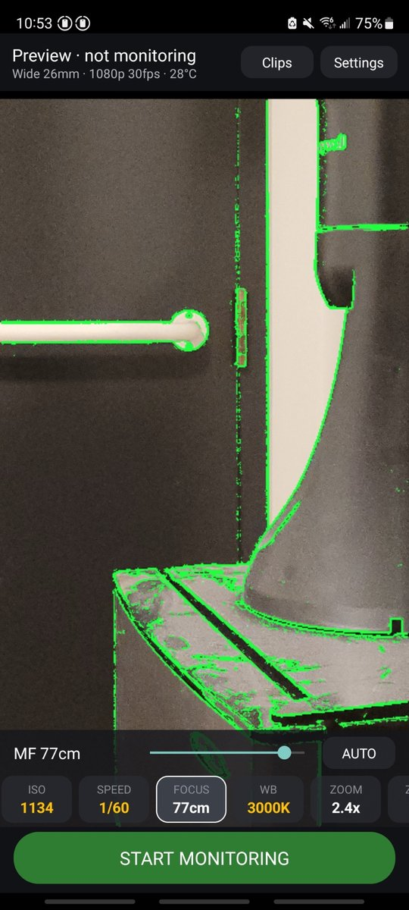
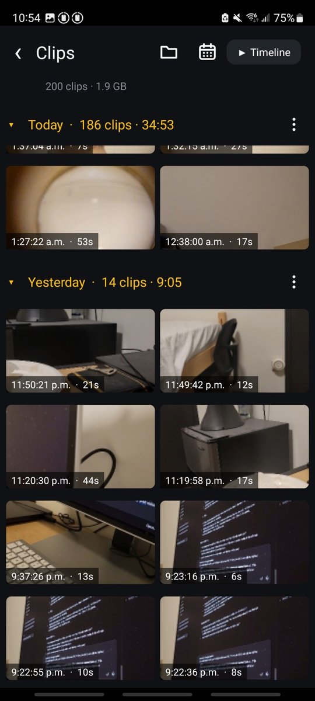
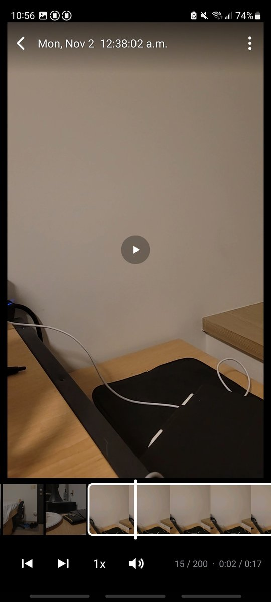
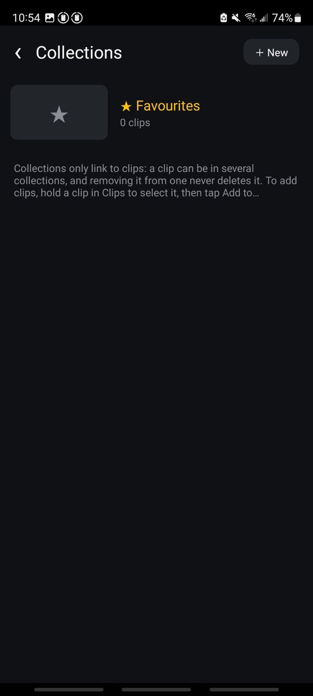

Vibe coded Android app that turns your phone into a security surveillance camera.
After trying the popular apps like Alfred and IP Webcam, they were either filled with ads, locked features behind subscriptions, or lacked manual camera adjustments.

Tested on a S23 Ultra and S20 FE which ran 24/7.
Cap phone at 70% CPU usage and turn off fast charging to reduce temperatures.

## ⬇ Download

**[Download the latest MotionCam.apk](https://github.com/gac2003/Android-Motion-Activated-Camera/releases/latest/download/MotionCam.apk)** · [all releases](https://github.com/gac2003/Android-Motion-Activated-Camera/releases)

1. Open the link on your Android phone (Android 11 or newer).
2. Open the downloaded file and allow your browser / file manager to install apps when asked.
3. Google Play Protect may warn that the app is unknown (it isn't on the Play Store) — choose *Install anyway*.

New versions install over the old one and keep your settings and clips.

[Privacy policy](PRIVACY.md) · [MIT License](LICENSE)

# What is MotionCam?

A motion-triggered security camera for Android (built for a Galaxy S20 FE, works on any Android 11+ phone).

* Records only when something moves; keeps recording until there has been no motion for N seconds (default 30, adjustable 0–600).
* **No accidental clips when you stop it** (optional): picking the phone up to turn monitoring off usually starts a clip;
  one shorter than 1 s (adjustable) can be discarded automatically, with a few seconds to Undo.
* **Pick the exact lens** (main / ultra-wide / telephoto / front) – not just "front" or "rear".
* **Pro Video style controls**: EV, ISO, shutter speed, manual focus (with focus peaking), white balance, zoom, resolution/fps.
* 1080p / 30 fps H.264 by default (720p, 4K, 24/60 fps and HEVC are options).
* Runs as a foreground service so it keeps working with the screen off.
* **Remote viewing without Wi-Fi/LAN**: built-in web page with live MJPEG + clip download, reachable over USB tethering, `adb forward`, Bluetooth tethering or the phone's own hotspot.
* Protects the phone (all optional): pauses the camera when hot, stops when the battery is low, can delete old clips.
* **Live connection** (optional): your phones connected through the internet, also on captive / isolated networks – camera
  status and alerts, live view, remote control and instant sync between phones.
* **Remote folders**: watch the clips another phone backs up (Google Drive, Dropbox, FTP/SFTP) in the same gallery and timeline player, and protect the ones you want kept.

| Pro controls & focus peaking | Clips gallery | Timeline player | Collections |
|:---:|:---:|:---:|:---:|
|  |  |  |  |
| Manual focus (green = sharp edges), ISO, shutter, WB and zoom like a Pro video mode; yellow = automatic | Day sections, sticky headers, calendar, multi-select | Plays clips back to back with a scrubbable filmstrip | Group clips into collections (soft links) |

## Build the APK

### Option A – download a build
Every push to `main` is built by GitHub Actions and published under **Releases** as `MotionCam.apk`
(the download link at the top always points to the newest one).

### Option B – Android Studio
Open this folder in Android Studio (Hedgehog or newer), let it sync, then *Build → Build APK(s)*, or press Run with the phone connected over USB.

### Option C – command line
With the Android SDK installed (`ANDROID_HOME` set, platform 34): `./gradlew assembleDebug` → `app/build/outputs/apk/debug/app-debug.apk`.

### Your own credentials
Builds you make don't use anyone else's accounts: Google Drive, Dropbox and the live connection use **your own** free
Google Cloud / Dropbox / Firebase projects. **[SETUP.md](SETUP.md)** walks through each one (about 10 minutes each);
the values go in `credentials.properties` (local) or repository variables (GitHub Actions). Features you skip are just
off in your build.

## First run
1. Open the app. The live preview starts right away (no monitoring needed), so you can set everything up first.
2. Use the bottom strip like the Pro Video mode:
   * **LENS / FORMAT** – pick the exact camera and resolution/fps.
   * **EV, ISO, SPEED, FOCUS, WB, ZOOM** – yellow values are AUTO and show what the camera is currently using
     (e.g. ISO 320, 1/60). Drag the slider to switch that control to manual, starting from the current value;
     tap AUTO to go back. Tap the value text to type an exact number.
   * **FOCUS** shows green focus peaking while it is open.
   * **ZONES** shows detected motion in red; drag on the image to mask areas (dark = ignored). The slider is sensitivity.
3. Tap **START MONITORING**, then lock the phone. Stop from the notification or the app.
   * Optional (off by default): turn on Settings → Recording → *Discard very short clips when I stop monitoring*.
     Then, if a clip shorter than 1 s is recording when you tap **STOP MONITORING** (usually set off by picking the
     phone up), it is discarded and a small *Short clip discarded · UNDO* pill appears in the top-right corner for
     9 seconds. Tap it and confirm to keep the clip. The length is adjustable (slider, or type any length from 0.5
     to 10 s, e.g. 1.2). Clips that end on their own and stops from the notification are never affected.
4. Settings → *Exempt from battery optimisation*. Set *Video rotation* explicitly if the phone is on a fixed stand.

Clips are saved to **Movies/MotionCam** (visible in Gallery and over USB file transfer). A clip's ⋮ in the player
(or *More* when clips are selected) has **Show in file manager** – Samsung's My Files, or the phone's Files app – and
**Open in another app**.
The **Clips** screen shows thumbnails by day; tapping a clip opens the **player**, which plays every following clip
back to back like one continuous video. Below the video is a filmstrip (like modern phone gallery players): the playing clip is expanded
into its frames (tap it to collapse/expand; one frame per second, pinch for more – down to exact frames – or fewer), drag to scrub (stops at the clip's ends while expanded; letting go at the end stays there, paused).
Tap the video to pause/play, double-tap left/right to skip within the clip (1 s by default; the **±1s** button below the
filmstrip or Settings → Player changes it to 0.5–10 s or **frame by frame**, and keep tapping to keep skipping); the ⋮ menu has share / open with / delete.

Long-press any control button on the main screen to choose which buttons are shown and their order.

## Motion detection tips (peephole / windows)
* *Light filter → Strong* ignores reflections, glare and light sweeping across the scene; *Normal* ignores
  lights switching on/off and exposure changes.
* Mask everything outside the peephole circle with **ZONES**.
* Raise *Motion must last at least* (e.g. 500 ms) to ignore brief flashes.

## Cloud backup (optional)
Backing up and viewing are the same thing: **remote folders** (cloud folders of clips). Clips → **Remote Folders** lists
them; tapping one shows its clips. **＋ Add → Add remote folder**: pick **Google Drive**, **Dropbox**, a Dropbox viewer
link, an **FTP/FTPS** or **SFTP** server, sign in, then **create a new folder** or open an existing one, and choose
whether this phone backs up its new clips there. Every folder has a **Back up new clips here** switch (one folder per
service; a viewer link is view-only), so footage survives if the phone is damaged or stolen and other phones can watch
it. The screen also has the **Upload queue** and **Clear downloaded clips**; its ⚙ opens the folder settings (upload
only on Wi-Fi / while charging, quality, delete the phone copy, thumbnails, FTP/SFTP, keep a copy), which are also in the
app's Settings. Each backed-up folder's ⋮ → *Backup settings* has its account, clean-up rules and viewer link.

* **Back up older clips**: select them in Clips and tap **Back up** (or *Back up all* in a collection).

* **Connect**: Google Drive uses the phone's Google account picker; Dropbox opens a sign-in page; FTP/SFTP take the
  server address and login (stored encrypted on the phone).
* **Limited access**: Google Drive uses `drive.file` (MotionCam only sees files it created), Dropbox uses an App folder
  (`Apps/MotionCam`). Only MotionCam's own `MC_….mp4` clips in the backup folder are ever deleted.
* **Folder**: created automatically ("MotionCam"), or choose / create another one.
* **When full**: delete the oldest backed-up clips to make room, or pause and notify. Optional size cap and
  "delete cloud copies after N days". **Protected** clips are never deleted (see below).
* **Reliable**: uploads are queued, resume where they stopped after a connection drop, retry with back-off, wait for a
  working connection (e.g. a Wi-Fi login page) and continue in the background, even after a reboot.
* **Options**: Wi-Fi only, charging only, upload as original / 720p / 480p, delete the phone copy once backed up.
* **Thumbnails for other devices**: each clip's peak-motion thumbnail (~20 KB) is uploaded to a `.thumbnails`
  subfolder, so remote folders show the right frame without downloading videos.

### Protected in cloud
Clips can be **protected** so the camera phone's clean-up never deletes their cloud copy – from **any** phone signed
in to the account:
* **Automatically**: clips in the camera phone's protected collections (the folder's ⋮ → Backup settings → *Choose protected
  collections*, Favourites by default), and clips you favourite or add to a collection while viewing the folder
  as a remote folder on another phone.
* **By hand**: select clips (or use the player's ⋮ menu) → *Protect in cloud* / *Remove cloud protection*; whole
  collections (⋮ next to the collection) and whole days (⋮ on the day header) at once.
* **See and override**: Collections → **Protected in cloud** lists every protected clip with the reason – *protected
  by hand* or *in "Garage" on Pixel 7* – and which phone set it. Any phone can **Remove protection** from any clip,
  even one kept by another phone's collection. The *Removed* filter lists clips whose protection was removed (by whom,
when) so they can be selected and **protected again** in one go.
* Badges: 🔒 protected · ⚠ in your collection but someone removed the protection · ☁✕ (camera phone collections) not
  in the cloud. A viewing phone saves a copy of a collection clip whose protection was removed (Settings → Remote
  folders, on by default), so its collection keeps it.
* Stored as hidden app properties on the clip in Google Drive, and as tiny files in a `.keep` subfolder on Dropbox,
  FTP and SFTP. If the cloud is full and only protected clips are left, uploads pause and you are notified.

## Remote folders (view another phone's backups)
Clips → **Remote folders** opens backup folders from other devices in the normal gallery and timeline player: day
sections, calendar, **shared collections**, filmstrip and back-to-back playback.
Clips are never uploaded or renamed there. **Delete from cloud** (selection, day menu or player ⋮; same confirmation as
on the phone) deletes clips that are not protected, with their thumbnail, marks and collection entries; protected clips
are always kept. Dropbox viewer links are fully read-only.

* **Google Drive**: sign in on the viewing device with the **same Google account** the recording phone backs up
  to (＋ Add → Google Drive) and pick the folder. Other Google accounts aren't supported, because MotionCam's
  `drive.file` access only sees files MotionCam itself created in the signed-in account.
* **Dropbox, same account**: ＋ Add → "my own backups".
* **Dropbox, another account**: on the recording phone, Remote Folders → its Dropbox folder's ⋮ → Backup settings → **Create viewer link**, send it,
  and paste it on the viewing device (＋ Add → "a viewer link"). Anyone with the link can view; **Revoke link** stops it.
* **FTP / SFTP**: enter the server login (a read-only account is best). Can be turned off under Remote folder options.
* **Shared collections**: a remote folder's Favourites and collections are the same on every phone signed in to the
  account (stored in a hidden `.collections` folder); any phone can create, rename, delete and fill them. Changes
  show at once, are queued when offline and sync automatically. Clips in them are protected from clean-up.
  * Phones never overwrite each other (one tiny file per entry). When intents clash – renamed on two phones, deleted
    on one while added to on another, the same name created twice, a change that keeps failing – the change is held
    and **Collections → Sync status** asks you (keep mine / theirs, restore, merge, retry…). It also lists waiting
    changes and has last-resort tools: discard unsent changes, re-download, re-upload this phone's copy (merge only).
  * Clips deleted from the cloud stay in the collection as **Missing** tiles (remove them any time); they are removed
    automatically only after 7 days and several listings without them. The camera phone's clean-up removes the
    entries of clips it deletes.
  * **Save all** (remote collection) downloads every clip to the phone; **Back up all** (phone collection) uploads.
  * Collections of the phone's own clips stay local. Older per-phone remote collections are moved to the shared ones
    (same names merged).
* Clips stream when played (FTP/SFTP download first) and are cached (up to 1.5 GB) so replaying is instant.
  **Save to phone** copies clips into this phone's Clips; those copies are never uploaded to cloud backup and are
  never deleted by the phone's automatic clean-up (age limit, size cap, low storage) – only when you delete them.

## Live connection (optional)
Settings → **Live connection** links your phones through Firebase (Google's realtime database, free tier). Phones only
make outgoing connections, so it works on captive Wi-Fi and networks that block local devices.

* **Join**: sign in with the same **Google account** on every phone (basic profile only), or use a **network code**
  (no Google account; everything is encrypted with the code). The phone list shows which phones are connected.
* **Viewer only or camera**: when turning it on, choose whether the phone only watches (it is never shown or
  controllable as a camera) or may also be a camera – which always requires a **PIN**.
* **Camera phones** (while monitoring) share their status – monitoring / recording, battery, charging, temperature, last
  motion, lens and format – and events: motion, clip saved, monitoring stopped (and why), too hot, charger unplugged.
* **Other phones** get alerts that don't nag: one motion alert per camera per N minutes (more motion updates it
  silently), battery once below a threshold, "offline" only after N minutes and only for a camera that was monitoring,
  quiet hours, per-camera mute (also from the alert), a separate Android channel per alert type for sound/vibration.
  Alerts arrive while MotionCam is open; **Stay connected** (silent notification) keeps them coming when it is closed.
  Without it, MotionCam **checks about every 15 minutes** (connects for a few seconds; alerts can be up to ~15 min late),
  and nothing is lost: cameras keep 7 days of events, and what was missed is added to the Alerts list at its own time
  (motion and clips summarised per camera) with a "While you were away" banner when MotionCam opens.
* **Alerts open the clip**: once the camera saves the clip a motion alert recorded, the alert (notification, Alerts list,
  Activity log) says "tap to watch" and plays it from the camera's cloud backup – waiting for the upload if needed.
  This needs the camera's backup folder added once under Clips → Remote Folders; the screen explains if it isn't.
  Or choose **inside MotionCam only**: a card on the open screen and the Alerts list, nothing in the notification shade.
  In-app cards stack like the phone's notifications (one in front, "+N more" with layers behind): swipe a card sideways
  to dismiss it, up to dismiss all, tap to open; they hide by themselves after a few seconds.
* **Remote camera**: low-rate live view (a frame every 2 s, only while watched, stops after 3 min), a **high-quality
  frame** on request (shown under the live view; tap for full screen, save it to Pictures/MotionCam), the camera
  controls (lens, exposure, ISO, shutter, focus, white balance, zoom), recording and motion settings, start / pause /
  resume / stop monitoring, and the camera's **Activity** log (7 days). Settings changed remotely are drafts until you
  tap **Save** (or **Cancel**) in the bar that stays at the bottom of the screen; leaving with unsaved changes asks first.
* **Full screen** live view: laid out like the camera screen – the picture fills the screen, status on top, and the same
  control buttons (lens, format, EV, ISO, shutter, focus, white balance, zoom) with their slider and AUTO, plus Start /
  Stop monitoring. Changes are lined up (shown at once on the buttons) and sent together with **Save** (or dropped with
  **Cancel**), since a remote change shows in the picture a few seconds later. Tap the value to type an exact number;
  tap the picture to hide the controls; works in landscape.
* **Standby** (camera phones, on by default): when monitoring stops, the phone stays connected with the camera off (a
  "standby" notification with Start / Turn off), so another phone can start monitoring again. It begins whenever
  MotionCam is opened on the camera phone. Most reliable while charging (Android may delay messages to a sleeping phone).
* **The remote**: only one phone at a time can change a camera (settings, start/pause/stop). The first change takes a
  free remote; another phone can **take it over** (the previous holder and the others are told). It frees itself after
  15 minutes without changes, or with *Give the remote back*. Everyone can still watch and get alerts.
* **PIN**: every camera phone has one (6+ characters); it protects controls and settings and, by default, the live view
  and frames. Requests are signed with it (never sent; slow hashing against offline guessing); 5 wrong PINs lock remote
  control for 10 minutes, doubling each time. Network codes are always made by the app (20 random characters, ~99 bits).
* **Sync**: a change to shared collections, protections or new clips nudges the other phones, which sync within seconds.
  Sync status shows which phone still has unsent changes or a conflict to decide.
* The published builds use the author's Firebase project. Your own builds use yours: see [SETUP.md](SETUP.md)
  (database rules in `firebase/database.rules.json`).

## Remote viewing
The web viewer password is shown/changed in Settings (user name: `admin`). The app lists the phone's addresses, e.g. `http://192.168.42.129:8080`.

| Link | How |
|---|---|
| USB tethering | Settings → *Hotspot & tethering* (Samsung: Connections → Mobile Hotspot and Tethering) → *USB tethering*; browse to the tether address on the PC |
| USB debugging | `adb forward tcp:8080 tcp:8080` then open `http://localhost:8080` |
| Bluetooth | Pair, enable *Bluetooth tethering* on the phone; low frame rate |
| Hotspot | Join the phone's hotspot from the laptop |

Do not forward the port to the internet; it is a plain-HTTP server with a simple password.

## Notes and limits
* Motion analysis runs 8×/s on a 1280x720 luma stream. The recorder is permanently connected to the camera and
  prepared in advance, so a clip starts roughly 0.25 s (the *motion must last* time) after motion begins.
* Manual white balance uses the camera's presets (incandescent … shade) rather than free Kelvin values, because raw gains are not portable across phones.
* Every lens the phone makes available to apps is listed. Some manufacturers hide extra lenses (ultra-wide, telephoto) from third-party apps; if a lens is missing from the list, the phone doesn't expose it.
* Android 14 does not allow camera foreground services to auto-start at boot, so monitoring must be started by opening the app.
* A debug-signed APK is fine for personal use.
